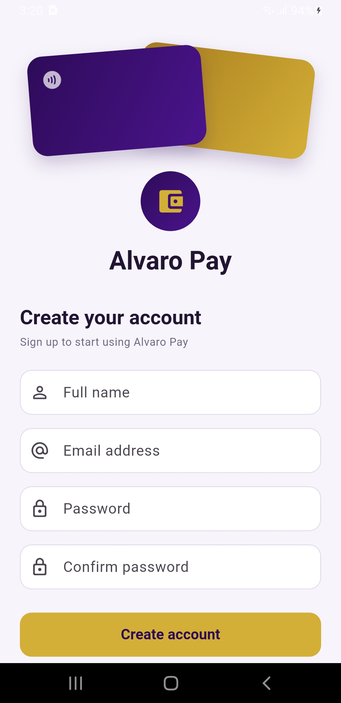
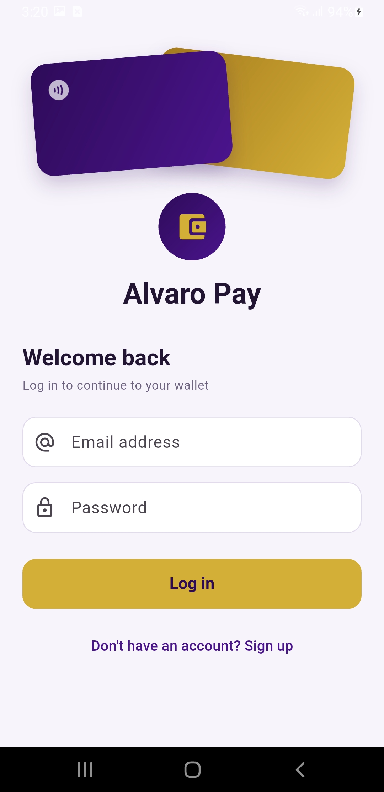
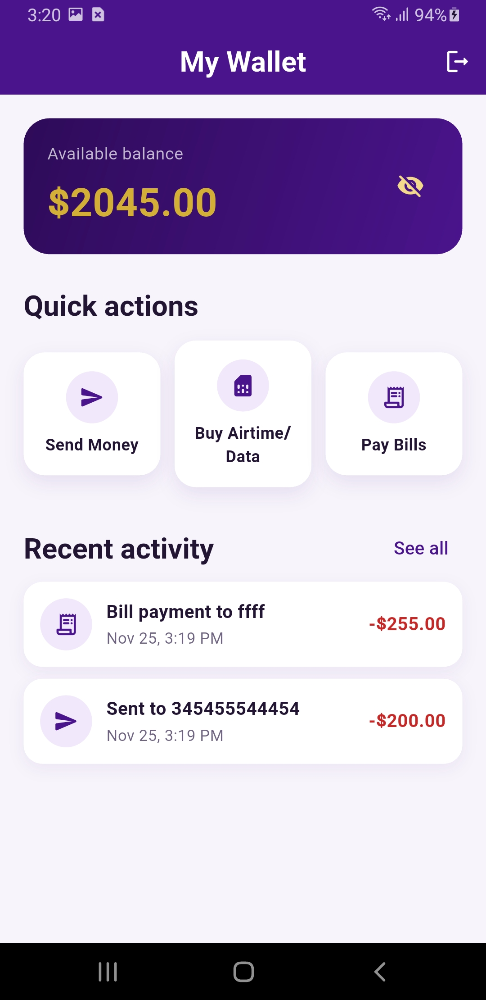

# Alvaro Pay (demo)

A small wallet-app demo built in Flutter: log in or sign up, then send
money, buy airtime/data, or pay a bill from a wallet home screen. It's a
mock backend (in-memory, no real server) built to show the architecture,
not a production payment app.

## Why this project exists

This isn't meant to be a real payments app - there's no server, no real
money movement, and no persistence beyond a single device's local
storage. The point of it is to show, in a small enough codebase to read
in one sitting, how a Flutter app can be structured so that:

- the business rules (what counts as a valid transfer, what "insufficient
  balance" means) live in plain Dart with no Flutter or UI code mixed in,
  so they could be unit-tested or reused without a screen at all;
- the UI layer (pages, widgets) only ever talks to a Bloc, never
  directly to a data source or a mock "backend" - so swapping the mock
  for a real API later would mean touching the `data/` layer only, not
  the screens;
- every piece of UI (buttons, text fields, icon badges, the balance
  card) is a small reusable widget rather than copy-pasted markup, and
  every string and color comes from one place (localization files, the
  theme) instead of being hardcoded per screen.

In short: it's a worked example of Clean Architecture + BLoC on a
feature set (auth, a wallet, three kinds of payment action, history)
that's realistic enough to show the pattern paying off, without the size
of an actual production app.

## Walkthrough

1. **Login / Sign up** - one screen, switching between the two modes in
   place rather than navigating to a separate page. Sign up asks for a
   full name and a confirmed password; both modes validate email format
   and a minimum password length before ever contacting the (mock)
   backend.
2. **Wallet home** - once logged in, this is the main screen: your
   balance, three quick actions (Send Money, Buy Airtime/Data, Pay
   Bills), and a short list of your most recent transactions.
3. **Send Money / Buy Airtime / Pay Bills** - each is its own small form.
   They all follow the same shape (fill in a form, submit, see a loading
   state, then success or a clear error) but validate different things:
   a recipient (email or phone) for Send Money, a phone number for Buy
   Airtime, a biller + account number for Pay Bills - and all three
   check the amount against your current balance before submitting.
4. **Transaction history** - every successful action from step 3 is
   recorded and shown here, newest first, with its type, counterpart,
   amount and time.
5. Close the app and reopen it: you're taken straight back to the
   wallet home screen, because your session was remembered. Log out
   from the wallet screen's app bar to clear it and return to step 1.

## Screenshots

| Sign up | Log in | Wallet home |
| --- | --- | --- |
|  |  |  |

## What's in it

- **Login / sign up** on one screen, switching mode in place, with a
  hand-built "payment cards" illustration above the form.
- **Session persistence** - logging in or signing up saves a lightweight
  local session (via `shared_preferences`), so relaunching the app skips
  straight to the wallet home screen instead of asking you to log in
  again. A short splash screen (`AuthGate`) checks for that session at
  launch. Logging out clears it and returns you to the login screen.
- **Wallet home** - a purple/gold balance card (tap the eye icon to
  hide/show it, with an animated swap) plus three quick actions: Send
  Money, Buy Airtime/Data, Pay Bills. Each action tile scales down
  slightly on press for tactile feedback.
- **Transaction history** - every successful send/airtime/bill action is
  recorded with a type, counterpart, amount and timestamp. The wallet
  home screen shows the 3 most recent under "Recent activity", with a
  "See all" link to a full history list (empty-state included).
- Each action opens its own form with real validation (a valid email-or-
  phone recipient, a valid phone number for airtime, amounts limited to
  2 decimal places, and a client-side check that you can't enter more
  than your current balance) before it ever reaches the mock backend.
  A successful action shows an animated success sheet (not just a
  snackbar) before returning you to the wallet.
- Premium-style icon badges (`IconBadge`) are used consistently for
  quick actions and transaction rows, and screen-to-screen navigation
  uses a soft fade/slide-up transition instead of the platform default.
- Elements on the wallet home and login/sign-up screens fade and slide
  into place on first appearance (staggered, via a small reusable
  `FadeSlideIn` widget), new transaction rows animate in individually
  rather than the whole list refreshing at once, the balance figure
  counts up/down whenever it changes instead of jumping straight to the
  new number, and the sign-up-only fields grow/shrink and fade in and
  out when you switch between Log in and Sign up.
- All text goes through Flutter's localization system (ARB files), and
  all colors go through one theme file - nothing is hardcoded in the
  screens themselves.

## How it's built

Clean Architecture, split by feature:

```
lib/
  core/            theme (purple/gold), DI, error types, validators,
                    page transitions, shared widgets (button, text
                    field, logo, icon badge, card illustration,
                    success sheet)
  features/
    auth/
      domain/      entity, repository contract, login/sign-up/session
                    use cases
      data/        mock data source, local session data source
                    (shared_preferences), repository implementation
      presentation/  AuthBloc + AuthGate (splash/session check) + the
                    login/sign-up page
    wallet/
      domain/      wallet + transaction entities, repository contract,
                    5 use cases (get wallet, send, buy airtime, pay
                    bill, get transaction history)
      data/        mock data source (keeps balance + history in
                    memory), repository implementation
      presentation/  WalletBloc + home page + 3 action pages +
                    transaction history page + transaction tile widget
  l10n/            app_en.arb (source strings)
```

Each feature follows the same rule: **domain** has no Flutter imports at
all (just entities, a repository interface, and use cases); **data**
implements that interface against a mock data source; **presentation**
is a Bloc plus the widgets that react to it. Errors are typed
(`Failure` subclasses - validation, insufficient balance, server) and
flow through `Either<Failure, T>` instead of try/catch scattered across
the UI.

Shared, reusable pieces live in `core/widgets/`: `AppPrimaryButton`,
`AppTextField`, `AppLogo`, `IconBadge`, `WalletCardIllustration`,
`WalletActionButton`, `BalanceCard`, `showSuccessSheet`. Every screen is
built from these rather than one-off widgets per page. There's no image-
asset pipeline in this demo, so "images" are hand-built vector
illustrations (gradients + shapes), not bitmaps - noted in code comments
where they're used.

## Running it

Built and tested with **Flutter 3.42.2** (check yours with
`flutter --version`).

```
flutter pub get
flutter gen-l10n
flutter run
```

`flutter gen-l10n` generates `lib/l10n/generated/app_localizations.dart`
from `lib/l10n/app_en.arb` - every screen imports that generated file,
so this step has to run before `flutter analyze`/`flutter run`/`flutter
test` will work. (`generate: true` in `pubspec.yaml` also makes `flutter
pub get` trigger it automatically in most setups, but running it by hand
once is the safe bet.)

Try it end to end: sign up with any name/email/password (6+ characters),
you'll land on the wallet home screen with a starting balance of
$2,500. Send money, buy airtime, or pay a bill to see it show up under
"Recent activity" and the balance update; try an amount larger than your
balance to see the client-side error before anything is submitted.
Close and relaunch the app and you'll land straight back on the wallet
home screen (no login needed) until you tap the logout icon.

## Testing

```
flutter test
```

- `test/features/auth/auth_bloc_test.dart` - login success, login
  failure, and mode toggling, with a mocked `AuthRepository`.
- `test/features/wallet/wallet_bloc_test.dart` - loading the wallet
  (balance + history), a successful send that updates the balance, and
  a send that exceeds the balance.
- `test/widget_test.dart` - a smoke test that the app launches to the
  login screen (with `SharedPreferences.setMockInitialValues({})` so
  `AuthGate`'s session check resolves to "no user" immediately).
